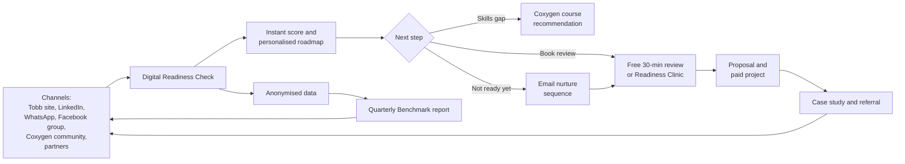

# Proposal: The Tobb Digital Readiness Check

**A long-term client acquisition and authority-building programme for Tobb Technologies and Coxygen Universities**

| | |
|---|---|
| **Prepared for** | Tobb Technologies (Pty) Ltd and Coxygen Global (Pty) Ltd |
| **Prepared by** | [Your name] |
| **Date** | October 2026 |
| **Version** | 1.0 (for review) |

Numbers in square brackets, such as [3], refer to the [reference list](#11-references) at the end of this document. Each reference number matches an evidence ID (reference [3] is E03) in the [`evidence/`](./evidence/README.md) folder, which also grades each source and lists the limits of the evidence. The working prototype and ready-to-use copy are in [`market-asset/`](./market-asset/README.md).

---

## Contents

1. [Executive summary](#1-executive-summary)
2. [Company profile: what Tobb and Coxygen offer](#2-company-profile-what-tobb-and-coxygen-offer)
3. [The opportunity](#3-the-opportunity)
4. [Reasoning: why this idea](#4-reasoning-why-this-idea)
5. [The solution](#5-the-solution)
6. [Who needs it](#6-who-needs-it)
7. [Implementation plan](#7-implementation-plan)
8. [Benefits to Tobb and Coxygen](#8-benefits-to-tobb-and-coxygen)
9. [Measuring success](#9-measuring-success)
10. [Risks and mitigation](#10-risks-and-mitigation)
11. [References](#11-references)

---

## 1. Executive summary

Tobb Technologies has been delivering software, hosting, networking and IT consulting since 2006 [1]. Its sister platform, Coxygen Universities, offers practical technology training in areas such as full-stack development, Cardano and blockchain, AI and cybersecurity [2]. Together they cover a lot of ground, but the public sites do not yet give a first-time visitor a simple answer to the question every prospect asks: *"What do I actually need, and where do I start?"*

This proposal recommends a single, practical marketing asset to answer that question: the **Tobb Digital Readiness Check**. It is a free, five-minute web assessment that scores an organisation across six pillars of digital capability and returns an instant, personalised roadmap that points to specific Tobb services and Coxygen courses.

The Check is supported by two recurring activities:

- A **quarterly Digital Readiness Benchmark**, built from anonymised results, which gives Tobb original data and a reason for the media, partners and prospects to keep coming back.
- A monthly **Readiness Clinic**, run by supervised Tobb interns, which converts results into conversations and gives graduates real client experience.

The idea is timely because South African SMEs are investing in digital tools [3][4], POPIA enforcement is tightening [8][9], employers report a persistent gap in practical digital skills [12][13], and youth unemployment is at a very high 47.4% [14]. It is also practical, because it can be built on the PHP and MySQL stack Tobb already uses and it relies mostly on staff and intern time rather than paid advertising.

Under a conservative base case, twelve months of operation would produce roughly 700 completed assessments, about 280 qualified leads and around 8 new client projects, with the benchmark report and community goodwill continuing to compound afterwards. These figures are planning assumptions, explained in [section 9](#9-measuring-success).

---

## 2. Company profile: what Tobb and Coxygen offer

### 2.1 Tobb Technologies

Based on the public site [1]:

- **History:** operating since 2006, formerly known as Now IT Wiz, founded by Bernard Sibanda. Directors and key shareholders are three women, two of whom are IT graduates.
- **Mission:** to bridge the digital divide through quality, affordable and sustainable IT services and products. Core values include customer focus, reducing unemployment, quality products and empowering women in IT.
- **Services:** IT consulting and software engineering (e-commerce, learning management, CRM, ERP, project management, inventory and database systems, mobile and Windows apps), websites and domain registration, hosting, cloud storage and backups, SEO and web support, networking and hardware, onsite training, and process design and integration.
- **Way of working:** a lightweight Agile approach, open-source tools, design patterns and test-driven development. Tobb hosts and supports what it builds, and uses escrow for remote clients.
- **Track record:** a portfolio that includes municipal, education, finance, business and community systems, plus named partner companies and an internship programme for IT graduates.

### 2.2 Coxygen Universities

Based on the public site [2]:

- A training centre with courses, chapters, quizzes, projects, badges and certificates.
- Learning pathways in Haskell and Plutus, Cardano and Web3, Midnight and privacy technology, full-stack development, AI and emerging technology, and cybersecurity and digital skills.
- English and French learning options, an events platform, performance reports and a Cardano training wallet.
- Community channels (Telegram, Discord, GitHub wiki, video) and ecosystem links including Cardano, Project Catalyst and Intersect.

### 2.3 Strengths to build on

| Strength | Why it matters for this proposal |
|---|---|
| Nearly two decades of experience | Credibility that a new agency cannot claim |
| Broad, one-stop service range | Each assessment result can map to something Tobb can actually deliver |
| Own hosting and support | Tobb can run the Check itself and keep the data under its control |
| Internship programme and training platform | A ready-made pipeline for staffing the Readiness Clinic |
| Affordability and inclusion mission | An authentic angle for reaching small and under-served organisations |

### 2.4 Gaps this proposal addresses

From reading the public pages, these points limit how easily a new visitor can understand and trust the offer. They are observations, not criticisms, and most are quick to fix:

1. **A long, undifferentiated service menu.** There are dozens of service codes but no guided way to pick one.
2. **No visible proof points on the page text.** There are no testimonials, case studies with results, or published pricing, and several portfolio items are placeholders.
3. **Some dated or inconsistent details.** Examples include a link to COVID-19 information, a promotional banner with no visible terms, a WhatsApp number written in two different formats, several email domains, and some spelling errors.
4. **Two platforms, no clear bridge.** Visitors to Tobb are not shown how Coxygen's training helps them, and vice versa.

The Digital Readiness Check is designed to solve the first and fourth gaps directly. [Phase 0](#phase-0-foundations-weeks-1-2) of the plan addresses the second and third.

---

## 3. The opportunity

### 3.1 Small businesses are going digital, but unevenly

The Mastercard SME Confidence Index published in June 2026 found that South African SMEs are placing digital tools at the centre of their growth plans, with around 80% accepting online payments [3]. Xero's 2025 State of Small Business report found that South African small businesses increased their use of digital tools and expects further uptake of automation in 2026 [4]. Payfast's survey of its merchants shows how small the typical user is: 82.5% of respondents operate with fewer than ten employees [5].

At the same time, research on Gauteng SMEs identifies inadequate digital infrastructure among the main barriers to effective adoption [6], and a South African study found that website and social media presence positively influences brand trust and purchase intention [7]. Businesses that accept online payments but have weak websites, no backups or poor security are exactly the ones who benefit from a clear, prioritised readiness roadmap.

### 3.2 Regulation is creating urgency

The Information Regulator has moved from awareness-raising to formal enforcement of the Protection of Personal Information Act (POPIA), including compliance notices and administrative fines [8]. It held a media briefing on enforcement on 31 August 2026 [9], and Bowmans reports that the Regulator planned intensified investigations into non-compliance for the 2026/27 financial year [10]. Commentators note that fines of up to R10 million are possible for serious contraventions [11]. POPIA applies regardless of business size, and website forms, sign-ups and staff data are all in scope [9][11].

For Tobb, this is a natural reason for organisations to care about website quality, hosting, backups and access control, all of which are services Tobb already sells.

### 3.3 A skills gap on one side, unemployed graduates on the other

South Africa's labour market sends two opposing signals:

- **Employers cannot find practical digital skills.** The IITPSA ICT Skills Survey 2024 reports a mismatch between graduate readiness and industry needs, with many graduates lacking practical, work-ready experience [12]. ITWeb's April 2026 coverage says demand for digital and ICT skills far exceeds supply in specialist roles [13], and the preliminary 2026 Xpatweb Critical Skills Survey points to continuing technology shortages, including AI and emerging skills [15].
- **Young people cannot find work.** Stats SA's second-quarter 2026 survey put the official unemployment rate at 33.6% and the youth (15–34) rate at 47.4% [14]. A further report on the same survey found that 36.4% of 15–24-year-olds were not in employment, education or training [16]. The NYDA notes that graduate unemployment was 12.4%, compared with 39.2% for people without matric [17].

Tobb's internship programme and Coxygen's practical, project-based training sit exactly in this gap. A marketing programme that also creates supervised work experience for graduates strengthens both the commercial and the social case.

### 3.4 Interactive content converts better than static content

Marketing research consistently shows that interactive assessments outperform static forms and downloads. Vendor-reported benchmarks put quiz start-to-lead conversion around 40%, compared with a median of about 6.6% for standard lead-magnet landing pages [18][19]. These figures come from software vendors and measure *people who started a quiz*, not all visitors, so they should be read as optimistic [19]. Even so, the direction is clear, and a B2B assessment that reveals a prospect's needs is more useful than a generic enquiry form.

### 3.5 Summary of the opportunity

| Market signal | What it means for Tobb and Coxygen |
|---|---|
| SMEs are adopting digital tools [3][4] | Large pool of organisations that need practical help |
| Foundations are uneven [6] | Clear need for a diagnostic and roadmap |
| POPIA enforcement is rising [8][9] | A trust-based, urgent reason to act |
| Skills shortage and youth unemployment [12][13][14][16] | Strong case for Coxygen training and Tobb internships |
| Interactive content converts well [18][19] | Efficient, measurable lead generation |

---

## 4. Reasoning: why this idea

Several alternatives were considered before choosing the Digital Readiness Check.

| Option | Strength | Weakness | Verdict |
|---|---|---|---|
| Paid advertising only | Fast reach | Costly, stops when spending stops, no lasting asset | Use only to amplify |
| Generic redesign of the website | Needed for credibility | Does not by itself create demand or give prospects a next step | Do as Phase 0, not as the strategy |
| A free e-book or white paper | Easy to produce | Static; low completion and weak lead quality compared with interactive formats [18][19] | Replace with an interactive asset |
| Discount or free-hosting promotion | Attracts attention | Attracts price-focused buyers; erodes margin | Keep as a supporting offer only |
| **Interactive readiness assessment plus benchmark plus clinic** | Personalised, reusable, data-generating, aligns with mission | Needs careful design and POPIA-compliant handling | **Recommended** |

**Why it fits Tobb specifically**

1. **It matches the brand.** Tobb says it wants to add value, cut costs and bring efficiency to organisations [1]. A free diagnostic proves that promise before any money changes hands.
2. **It sells a menu through a conversation.** The Check translates a large service list into three to five specific recommendations for each prospect.
3. **It compounds over time.** Each run of the Check adds to a dataset that powers the next benchmark report, which in turn attracts more prospects.
4. **It is cheap to build and run.** It uses the PHP and MySQL skills Tobb already has, on infrastructure Tobb already hosts [1].
5. **It links both platforms and the social mission.** Skills results feed Coxygen, and clinics create work for interns, supporting Tobb's stated values on job creation and women in IT [1].

---

## 5. The solution

### 5.1 Component 1: The Digital Readiness Check

A responsive web page, available in English first, where an organisation answers about 24 multiple-choice questions (four per pillar) in roughly five minutes. No account is required. The results page appears immediately.

**The six pillars**

| # | Pillar | Example questions | Typical Tobb or Coxygen response |
|---|---|---|---|
| 1 | Online presence and discoverability | Do you have a mobile-friendly website? Is your business listed on Google? Do you use a branded email address? | Standard 5-page site (S5014), dynamic CMS site (DW015), SEO (SE006), branded email (WE005), logo and graphic design (LD007, GD009) |
| 2 | Digital operations and systems | How do you manage customers, stock and projects today? Are tasks still done on paper or in spreadsheets? | CRM (CR31), inventory and database applications (ID39), project management (PM37), process flow design and integration |
| 3 | Payments and e-commerce | Can customers pay online? Do you sell through your own channel? | Simple online store (CS017), advanced commercial site with internet payments (CA20), e-commerce application (ECW4) |
| 4 | Data protection and security | Do you have a privacy notice and an appointed Information Officer? Are backups tested? Who has access to what? | Backups (BU008), cloud storage, hosting and support, plus referral to a legal or compliance partner for the legal side |
| 5 | Skills and people | Can staff use core tools confidently? Is there a training plan? | Tobb onsite training, plus Coxygen full-stack, cybersecurity and digital skills and AI pathways |
| 6 | Infrastructure and hosting | Where is your website hosted? How reliable is your connectivity and equipment? | Domain and hosting (DR001, WH002), cloud solutions (CS003), networking and hardware |

**The output**

- An overall score from 0 to 100 and a score for each pillar, shown in a simple radar chart.
- A maturity band: *Foundation*, *Emerging*, *Established* or *Advanced*.
- The **top three quick wins**, written in plain language.
- A **90-day roadmap** mapped to Tobb services and, where relevant, Coxygen courses.
- A button to book a free 30-minute review, and an optional email or WhatsApp copy of the report.

**Design principles**

- *Value before contact details.* Show the headline score first, then ask for contact details to unlock the full report. This is the "quiz funnel" pattern described in the marketing literature [18].
- *Honest recommendations.* If a prospect scores well in a pillar, say so. Credibility is worth more than an upsell.
- *Plain language and mobile first.* Many prospects will open the link on a phone.
- *Not legal advice.* The data-protection pillar is a readiness indicator, not a compliance certificate, and must say so clearly.

### 5.2 Component 2: The quarterly Digital Readiness Benchmark

Once at least 100 assessments are completed, Tobb publishes an anonymised, aggregated report such as *"The State of Digital Readiness: South African SMEs, Schools and Clinics"*. It would include:

- Average scores by pillar, sector and company size.
- The most common gaps (for example, how many organisations have no tested backup).
- Three short case stories, with client permission, showing before and after scores.
- A short section linking findings to current regulation and skills data.

Aggregated data must never reveal an individual respondent. A minimum group size (for example, 10 responses) should apply before any breakdown is published. The report can be released as a web page, a downloadable PDF, a LinkedIn carousel and a press note.

### 5.3 Component 3: The Readiness Clinic

A free, monthly 45-minute session (online, with an occasional in-person session in Johannesburg) where Tobb staff and supervised interns:

1. Explain the benchmark and common gaps.
2. Review two or three volunteer results live (with consent).
3. Answer questions and book follow-up reviews.

Interns prepare the reviews and shadow senior staff. This gives them portfolio-grade client experience and addresses the work-readiness gap employers describe [12]. Coxygen learners who complete relevant modules can be invited to take part.

### 5.4 How the pieces work together

The final loops, from the benchmark and from case studies back to the channels, are what make this a long-term asset rather than a one-off campaign.

---

## 6. Who needs it

| Segment | Evidence of need | Primary offer | Best channel |
|---|---|---|---|
| **SMEs and start-ups (Gauteng first)** | Rapid adoption of digital payments and tools, with uneven foundations [3][4][6] | Websites, hosting, SEO, CRM, e-commerce, backups | LinkedIn, Facebook groups, local business chambers and incubators |
| **Schools, colleges and training providers** | Tobb already serves schools and builds learning systems [1]; the skills agenda is a national priority [12][13] | Learning management systems, websites, onsite training | Direct outreach, education associations |
| **NPOs, clinics and professional practices** | They hold sensitive personal data, and POPIA enforcement is rising [8][9][11] | Secure hosting, backups, privacy-aware forms, process design | Professional bodies, email, WhatsApp |
| **Software companies and agencies** | Tobb develops for other development companies [1] | White-label or overflow development | LinkedIn, GitHub, referral partners |
| **Municipalities and public bodies** | Tobb's portfolio includes a municipal system [1], though public procurement is slow | Specialist systems and support | Relationship-led, long cycle |
| **Learners, graduates and employers (Coxygen)** | High youth unemployment and a work-readiness gap [12][14][16][17] | Training, internships, certificates | Coxygen community channels, universities, TVET colleges |

**Suggested first focus:** SMEs and NPOs in Gauteng. They are close to Tobb's Johannesburg base, quick to decide, and have the clearest need for foundations and POPIA-aware practices.

---

## 7. Implementation plan

The plan is sequenced so that Tobb can test the idea cheaply and expand only when results justify it. Time estimates assume a small team (one developer, one marketer or business-development lead, and two to three interns). They should be adjusted to Tobb's actual capacity.

### Phase 0: Foundations (weeks 1-2)

| Task | Owner | Output |
|---|---|---|
| Fix credibility gaps on tobb.co.za (consistent phone and email, remove outdated links and spelling errors, add terms to promotions, complete placeholder portfolio items) | Developer | Clean, consistent site |
| Gather 3-5 short, permission-based case studies from existing clients | Business development | Proof points |
| Appoint an Information Officer, publish a privacy notice and consent wording for the Check | Management and legal reviewer | POPIA-ready data handling [11] |
| Define the six pillars, scoring rubric and service mapping | Founder and senior developer | Approved scoring document |

### Phase 1: Build the minimum viable Check (weeks 3-8)

| Task | Output |
|---|---|
| Write the 24 questions and plain-language result text | Question bank and report templates |
| Build the web app (PHP and MySQL), including scoring, radar chart, results page and email delivery | Working MVP on Tobb hosting |
| Add tracking: campaign tags on every link, a "How did you hear about us?" field and a unique result ID | Reliable attribution |
| Build the CRM view: each lead with score, pillar gaps, service matches and consent status | Sales-ready lead list |
| Pilot with 10-15 existing clients and friendly partners; fix confusing questions | Tested v1.0 |

### Phase 2: Launch (months 3-4)

| Task | Output |
|---|---|
| Announce on the Tobb home page, LinkedIn, the Tobb Facebook group, WhatsApp, and Coxygen's Telegram, Discord and GitHub channels | First wave of traffic |
| Publish 2-3 search-friendly articles (for example "Is your small business POPIA-ready?" and "Website checklist for South African SMEs") that link to the Check | Organic traffic |
| Set up a three-email follow-up sequence (results explained, quick-win guide, invitation to a review), sent only to people who opted in | Nurture flow |
| Approach 5-10 partners (business chambers, incubators, school networks, existing partner companies) about co-branded links | Distribution partnerships |
| Run the first Readiness Clinic | First interns and clients engaged |

### Phase 3: Benchmark and authority (months 5-6)

| Task | Output |
|---|---|
| Analyse the first 100+ completions; apply minimum group sizes | Aggregated findings |
| Publish the first Benchmark report and a media or newsletter pitch | Authority content |
| Host a launch webinar with Tobb and a guest speaker (for example a data-protection practitioner) | Lead generation event |
| Review results against targets and revise questions and CTAs | Version 1.1 |

### Phase 4: Scale and compound (month 7 onward)

- Publish a refreshed Benchmark each quarter, and an annual "year on year" edition.
- Offer existing clients a yearly re-check to show improvement and spot upsell needs.
- Introduce a referral incentive for clients and partners (for example a service credit).
- Add sector-specific versions (education, health, retail) and further languages.
- Launch a Coxygen-linked track where completing recommended modules improves a person's "Skills and people" score.
- Consider modest paid promotion (such as LinkedIn or Google ads) only when organic conversion rates are proven.

### Resources and budget guidance

The main cost is time, not software licences, because Tobb can host the tool itself. Management should fill in the table below once capacity is confirmed.

| Item | Estimate | To be confirmed by Tobb |
|---|---|---|
| Developer time for MVP | Roughly 4-6 weeks part-time | [ ] |
| Content and copywriting (questions, report text, 3 articles) | Roughly 2-3 weeks part-time | [ ] |
| Intern time for clinics and analysis | 2-3 interns, a few hours per week | [ ] |
| Legal review of privacy notice and disclaimers | One-off professional fee | [ ] |
| Optional paid promotion | Set a monthly cap only after Phase 3 | [ ] |

### Responsibilities (RACI summary)

| Activity | Founder | Developer | Business development | Interns |
|---|---|---|---|---|
| Scoring and service mapping | A | R | C | I |
| Build and maintain the Check | I | A/R | C | I |
| Content, campaigns and partnerships | C | I | A/R | C |
| Lead follow-up and sales | A | C | R | I |
| Benchmark analysis and report | A | C | R | R |
| Clinics | A | C | R | R |

*R = responsible, A = accountable, C = consulted, I = informed.*

---

## 8. Benefits to Tobb and Coxygen

### 8.1 Commercial benefits

- **Qualified pipeline.** Every lead arrives with a score, a list of gaps and suggested services, which shortens the sales conversation.
- **Lower acquisition cost over time.** The Check, the benchmark and the clinic keep working after the initial effort, unlike a paid campaign. Vendor sources suggest assessment-based content can lower blended cost per lead as organic completions grow, though this should be verified with Tobb's own data [18][19].
- **Better-fitting clients.** Self-assessment helps prospects see their own needs, which supports healthy projects rather than mismatched ones.
- **Repeat and recurring revenue.** Annual re-checks create a natural trigger for hosting renewals, support plans, upgrades and training.
- **Differentiation.** Few small South African IT firms publish their own benchmark data. That gives Tobb an authority position at little cost.

### 8.2 Brand and trust benefits

- Shows expertise instead of claiming it.
- Presents Tobb as a guide first and a seller second.
- Provides a modern, consistent front door once Phase 0 clean-up is done.

### 8.3 Social and strategic benefits

- **Jobs and skills.** Interns gain real experience, and Coxygen learners see a clear path from training to work, which directly supports Tobb's stated value of reducing unemployment [1] at a time of 47.4% youth unemployment [14].
- **Inclusion.** Plain-language, low-cost recommendations help small and under-served organisations take practical steps, in line with Tobb's mission to bridge the digital divide [1].
- **Platform synergy.** Tobb gains training to offer clients, and Coxygen gains a stream of learners and corporate upskilling leads.

### 8.4 Benefits to clients

- A free, honest self-assessment and prioritised action plan.
- Awareness of data-protection and security gaps before a regulator or incident exposes them [8][9].
- A clear route to affordable help, including the option to build skills in-house through Coxygen.

---

## 9. Measuring success

### 9.1 Measurement framework

Success is measured as a funnel from reach to revenue to impact, reviewed monthly and re-planned quarterly.

| Level | Metric | How it is captured | Review frequency |
|---|---|---|---|
| **Reach** | Unique visitors to the Check page, split by channel | Web analytics with campaign tags | Weekly |
| **Engagement** | Start rate (visitors who begin) and completion rate (starters who finish) | Event tracking in the app | Weekly |
| **Leads** | Share of completers who give contact details and marketing consent | Database | Weekly |
| **Quality** | Average score, share in each maturity band, number of pillars flagged | Database | Monthly |
| **Pipeline** | Reviews or clinics booked; quotes issued | CRM | Monthly |
| **Revenue** | New clients, project value won, cost per acquired client, payback period | CRM and accounting | Monthly |
| **Retention** | Clients retaking the Check after 12 months; score improvement | Database | Annual |
| **Authority** | Benchmark downloads, backlinks, media mentions, newsletter growth | Analytics and media tracking | Quarterly |
| **Social impact** | Interns participating, interns placed or retained, Coxygen learners referred or enrolled | Internship and LMS records | Quarterly |

### 9.2 Twelve-month planning model

The table below shows how the funnel could perform under three scenarios. The assumptions are deliberately more cautious than the vendor benchmarks in the literature [18][19], because those measure people who already started a quiz and come from software vendors with a commercial interest.

| Funnel step | Low | **Base** | High |
|---|---|---|---|
| Unique visits to the Check page (12 months) | 2,000 | **4,000** | 8,000 |
| Start rate | 20% | **25%** | 30% |
| Starts | 400 | **1,000** | 2,400 |
| Completion rate | 60% | **70%** | 75% |
| Completed assessments | 240 | **700** | 1,800 |
| Share of completers who become leads | 25% | **40%** | 50% |
| Leads | 60 | **280** | 900 |
| Share of leads who book a review | 8% | **12%** | 15% |
| Reviews held | about 5 | **about 34** | about 135 |
| Share of reviews that become paid projects | 20% | **25%** | 30% |
| **New client projects** | **about 1** | **about 8** | **about 40** |

**Reading the model**

- The base case implies about 3% of leads becoming clients, which is at the upper end of the roughly 1-3% lead-to-customer range that marketing blogs commonly quote for B2B lead generation (an indicative figure only, not drawn from a primary study). If real results are lower, the main levers are traffic, follow-up quality and the review-to-project close rate.
- **Revenue estimate:** new client projects multiplied by Tobb's average first-project value. This figure is internal to Tobb and is not public, so it is left blank: `Average first-project value: R ______`.
- **Break-even check:** total programme cost for the year divided by average first-project value gives the number of new projects needed to break even. Management can compare that to the model above.

### 9.3 Suggested targets and decision rules

| Time | Target | If missed |
|---|---|---|
| Day 90 (Phase 2 complete) | At least 150 starts; completion rate of 60% or more; at least 40 leads | Shorten the Check, simplify the first screen, improve the headline, add partner links |
| Month 6 | At least 100 completed assessments and first Benchmark published; at least 10 reviews held | Increase clinic frequency; add a partner co-branded launch |
| Month 12 | Base-case model reached (about 700 completions, 280 leads, about 8 clients) | Review traffic sources first, then sales follow-up, then the offer itself |
| Month 12 (impact) | At least 10 interns have taken part in clinics or reviews; Coxygen referrals tracked | Formalise intern rotations and add a Coxygen enrolment link in the result report |

### 9.4 Good measurement practice

- **Use unique result IDs and campaign tags** so each lead can be traced back to a channel, and ask "How did you hear about us?" as a cross-check.
- **A/B test one thing at a time** (headline, first question, call-to-action wording, length of the Check).
- **Compare with a baseline.** Record current monthly enquiries and wins for three months before launch, so the effect of the programme is visible rather than guessed.
- **Report quarterly to management** with the funnel, the cost per client, the lessons learned and the next experiment.

---

## 10. Risks and mitigation

| Risk | Likelihood | Impact | Mitigation |
|---|---|---|---|
| **Low traffic** to the Check page | Medium | High | Use partners, email signatures, community channels, SEO articles and clinics; add small paid promotion only after conversion is proven |
| **POPIA non-compliance by the tool itself** | Low if handled early | High | Appoint an Information Officer, collect only needed data, record explicit consent, store data securely, allow deletion on request, and obtain a legal review [11] |
| **Website credibility problems** reduce conversion | Medium | Medium | Complete Phase 0 first, and collect permission-based case studies |
| **Benchmarks are overstated** because they come from vendors | High | Medium | Use the conservative planning model; recalibrate after 90 days using Tobb's own data [19] |
| **Small sample size or self-selection bias** in the Benchmark | Medium | Medium | Label results clearly as "self-assessed, non-representative"; avoid claims about the whole country; only publish breakdowns above a minimum group size |
| **Capacity strain** on a small team | Medium | Medium | Automate the report and emails; run clinics monthly, not weekly; use supervised interns |
| **Over-promising in recommendations** | Low | High | Keep recommendations honest and include "no action needed" where relevant; add a clear disclaimer that results are indicative |
| **Scope creep** (too many sectors and languages too early) | Medium | Medium | Launch with Gauteng SMEs and NPOs in English; add segments only after hitting Month-6 targets |

---

## 11. References

*All web sources were accessed in October 2026. Figures are reported as published by the sources; where a source is a vendor or a commentator, this is noted.*

**Company sources**

1. Tobb Technologies (Pty) Ltd. *Company website.* <https://tobb.co.za/>
2. Coxygen Global (Pty) Ltd. *Coxygen Universities.* <https://coxygen.co/universities/index.php>

**SME and digital adoption**

3. Mastercard. *SME Confidence Index: South Africa's SMEs put digital tools at the heart of their growth plans* (18 June 2026), as published by BusinessTech. <https://businesstech.co.za/news/?p=863814>
4. Xero. *State of Small Business Report 2025*, as reported by Bizcommunity. <https://www.bizcommunity.com/article/sa-small-businesses-rebuilt-cash-flow-models-to-drive-growth-in-2025-061265a>
5. Payfast. *State of Pay 2025: Mzansi's digital leap*, via tralac. <https://www.tralac.org/documents/news/7236-payfast-state-of-pay-2025-mzansi-s-digital-leap.html>
6. Maling, B. P. *Digital adoption and business performance among small and medium enterprises in South Africa: evidence from Gauteng Province.* Genetics and Molecular Research 25 (12s), 2026. <https://geneticsmr.com/index.php/gmr/article/download/2940/1816/7691>
7. University of Pretoria. *Moderating role of online presence on brand trust and purchase intention in South African SMEs* (research report). <https://repository.up.ac.za/bitstreams/9085d082-1372-426c-8779-37024f1bf991/download>

**Data protection and regulation**

8. Bowmans. *Information Regulator launches POPIA monitoring exercise* (19 February 2026), via EBnet. <https://www.ebnet.co.za/?p=39185>
9. Werksmans Attorneys. *The Regulator is watching: new enforcement signals for POPIA and PAIA compliance* (briefing of 31 August 2026). <https://werksmans.com/the-regulator-is-watching-new-enforcement-signals-for-popia-and-paia-compliance/>
10. Bowmans. *South Africa: Data protection - recent developments and enforcement trends* (17 March 2026). <https://bowmanslaw.com/insights/south-africa-data-protection-recent-developments-and-enforcement-trends/>
11. ClearComply. *POPIA compliance hub* (commercial compliance provider; used for the maximum fine figure and practical summaries). <https://www.clearcomply.co.za/popia>

**Skills and labour market**

12. ITWeb. *SA's ICT skills crisis rooted in experience gap* (reporting on the IITPSA ICT Skills Survey 2024). <https://www.itweb.co.za/article/sas-ict-skills-crisis-rooted-in-experience-gap/DZQ58MV8RejvzXy2>
13. ITWeb. *Practical tech skills that actually boost employability in 2026* (24 April 2026). <https://itweb.co.za/article/practical-tech-skills-that-actually-boost-employability-in-2026/mYZRXv9gdOVMOgA8>
14. SAnews / Stats SA. *SA official unemployment rate rises to 33.6%* (Quarterly Labour Force Survey, Q2 2026; youth rate 47.4%). <https://www.sanews.gov.za/index.php/south-africa/sa-official-unemployment-rate-rises-336>
15. ITWeb. *AI skills add pressure to South Africa's tech talent gap* (29 September 2026, reporting preliminary Xpatweb 2026 Critical Skills Survey findings). <https://www.itweb.co.za/article/ai-skills-add-pressure-to-south-africas-tech-talent-gap/nWJad7bN3zY7bjO1>
16. allAfrica. *South Africa's "lost" generation: over a third of youth doing nothing* (4 September 2026, citing Stats SA Q2 2026). <https://allafrica.com/stories/202609040267.html>
17. National Youth Development Agency (NYDA) via gov.za. *NYDA notes with serious concern latest Quarterly Labour Force Survey (QLFS) - Q2.* <https://www.gov.za/news/media-statements/nyda-notes-serious-concern-latest-quarterly-labour-force-survey-qlfs-q2-12>

**Marketing benchmarks (vendor and industry sources; treat as indicative)**

18. Uplup. *Interactive content marketing guide* (citing Interact quiz data and Content Marketing Institute research). <https://uplup.com/blog/interactive-content-marketing-guide>
19. Digital Applied. *Lead magnet conversion benchmarks 2026: a B2B data guide* (1 June 2026). <https://www.digitalapplied.com/blog/lead-magnet-conversion-benchmarks-2026-b2b-data-reference>

---

### Disclaimer

This proposal was prepared from publicly available information about Tobb Technologies and Coxygen Universities and from the third-party sources listed above. It does not use any confidential company data. Financial projections are planning assumptions, not forecasts or guarantees. The POPIA-related content is general information, not legal advice, and any privacy notice, consent wording or disclaimers for the Digital Readiness Check should be reviewed by a qualified legal professional before launch.
